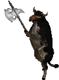
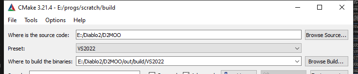
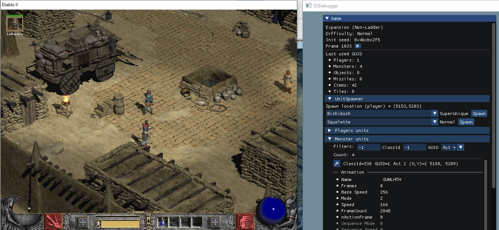

# D2MOO - Diablo II Method and Ordinal Overhaul



This project is a re-implementation of the Diablo2 game coupled with patching facilities for modders.
The aim is to provide the modding community with an easy tool to understand and patch the game.
To ensure that we stay as close as possible to the original game, we do not provide fixes for bugs (yet).

The game assets, main executable code and anything related to hacking or piracy is NOT endorsed by the authors, and as such we will not provide code related to such subjects.
The original game assets and binaries is required to use this project.

## Status

<a href="https://purplesmaug96.github.io/D2MOO/accuracy-report/D2COMMON.html"></a><a href="https://purplesmaug96.github.io/D2MOO/accuracy-report/D2GAME.html"></a><a href="https://purplesmaug96.github.io/D2MOO/accuracy-report/D2LANG.html"></a><a href="https://purplesmaug96.github.io/D2MOO/accuracy-report/D2WIN.html"></a><a href="https://purplesmaug96.github.io/D2MOO/accuracy-report/D2GFX.html"></a><a href="https://purplesmaug96.github.io/D2MOO/accuracy-report/D2NET.html"></a><a href="https://purplesmaug96.github.io/D2MOO/accuracy-report/D2CMP.html"></a><a href="https://purplesmaug96.github.io/D2MOO/accuracy-report/GAME.html"></a>

The badges compare the 1.10f retail binaries against the DLLs built from this
repository with [reccmp](https://github.com/reccmp/reccmp). Each one links to the
full per-function report.

| Binary | reccmp accuracy report |
| --- | --- |
| `D2Common.dll` | [D2COMMON.html](https://purplesmaug96.github.io/D2MOO/accuracy-report/D2COMMON.html) |
| `D2Game.dll` | [D2GAME.html](https://purplesmaug96.github.io/D2MOO/accuracy-report/D2GAME.html) |
| `D2Lang.dll` | [D2LANG.html](https://purplesmaug96.github.io/D2MOO/accuracy-report/D2LANG.html) |
| `D2Win.dll` | [D2WIN.html](https://purplesmaug96.github.io/D2MOO/accuracy-report/D2WIN.html) |
| `D2gfx.dll` | [D2GFX.html](https://purplesmaug96.github.io/D2MOO/accuracy-report/D2GFX.html) |
| `D2Net.dll` | [D2NET.html](https://purplesmaug96.github.io/D2MOO/accuracy-report/D2NET.html) |
| `D2CMP.dll` | [D2CMP.html](https://purplesmaug96.github.io/D2MOO/accuracy-report/D2CMP.html) |
| `Game.exe` | [GAME.html](https://purplesmaug96.github.io/D2MOO/accuracy-report/GAME.html) |

The compared binaries are available [here](https://nightly.link/Purplesmaug96/D2MOO/workflows/reccmp-ci/accuracy-thing/reccmp-builds.zip)

## How to build

### Dependencies

For the patching we rely on the [D2.Detours](https://github.com/Lectem/D2.Detours.git) project, which is included as a git submodule. (use the `git submodule update --init --recursive` command, or clone this project with `git clone --recursive`)
You will also need to install the [CMake](https://cmake.org) build system and Visual C++ (or any C++ compiler that can generate .DLLs on Windows) which are freely available.

### Build the project

The recommended way is to use CMake presets.
You can generate a VS solution (located in `out/build/VS20XX`) and build using the command-line:

```sh
# Configure the CMake project
cmake --preset DefaultGenerator
# Build the release config (Optional. You may do it from Visual Studio itself)
cmake --build --preset DefaultGenerator --config Release
# Install (Optional. Most people will want to debug instead of install)
cmake --build --preset DefaultGenerator --config Release --target install
```

Or using the CMake-gui:


You can replace `DefaultGenerator` by `VS2022` pr `Ninja` if you are using Visual Studio 2022.

### Building with Visual C++ 6.0

The `VC6` preset builds the game DLLs with VC6 (VS98) command line tools, which is
necessary to match the retail binaries as closely as possible. It doesn't
depend on a Visual Studio install: grab the thing from
[MSVC600](https://github.com/Purplesmaug96/MSVC600) and place it at `C:\MSVC600\VC98`, or
point `VCPP6_ROOT` somewhere else.

```sh
cmake --preset VC6
cmake --build --preset VC6
```

## Usage

If you are using a default Diablo2 install and generated `.sln` through *CMake*, you are good to go, simply build and run with `F5`!

Otherwise have a look at the [Advanced build and run](./doc/AdvancedBuildAndRun.md) and [Debugging](./doc/Debugging.md) documentation.

## Documentation

An embryo of documentation is available in the repository's [doc](./doc/) folder.

## D2MOO Debugger (Experimental!)

Start the game with the `-debug` argument.
For example: `D2.DetoursLauncher -- -debug`.  
Alternatively, you may set the environment variable `D2_DEBUGGER=1`.



## Versions

The project is currently based on the 1.10f version of the game.
Feel free to submit patches for other versions of the game!

## FAQ

### Why is the code so ugly and with names such as `a1`, `a2`, ... ?

The code was originally extracted using a reverse engineering tool, and slowly cleaned to use more understandable names.

### Can I build D2Common.dll and replace it directly with the one from the game ?

Yes this is now possible! However it is not guaranteed to be bugfree, so you may want to patch the functions you use instead.
We are in the (slow) process of checking each ordinal (exported functions) and patching them one by one. See [D2Common.patch.cpp](D2.Detours.patches/1.10f/D2Common.patch.cpp) for the current status of each ordinal.

This is **NOT** the case yet for other .dlls.

### Can I replace the game .dll files directly with the ones from D2MOO ?

NO !
As mentioned in the previous question, it only works with D2Common.dll (and is not bugfree).

### Why are some DLLs missing ?

Reversing the game is very time consuming. Since `D2Common.dll` and `D2Game.dll` contain most of the game logic, this is where the focus has been set. Any contribution and help is welcome !

### How can I write my own mod using this ?

The documentation for that is not written yet, please contact us directly on the Phrozen Keep [forums](https://www.d2mods.info) / [Discord server](https://discord.gg/NvfftHY).
More importantly, we need your [feedback](https://github.com/ThePhrozenKeep/D2MOO/issues/20) to determine a roadmap.

### Why yet another project for D2 modding and code editing ?

We felt that the current projects are not good enough, and more importantly did not cover enough parts of the game.
Having a centralized code that one can launch and use as reference will make it easier, we hope, for the modding community.

### I can not set breakpoints in Visual Studio

Please have a look at [Microsoft Child Process Debugging Power Tool](https://marketplace.visualstudio.com/items?itemName=vsdbgplat.MicrosoftChildProcessDebuggingPowerTool).

### I have other questions !

Please feel free to open an issue or visit the Phrozen Keep [forums](https://www.d2mods.info) / [Discord server](https://discord.gg/NvfftHY) !


## Credits

This could not have been done without the amazing help and work of the Phrozen Keep community!
Non-exhaustive list of members who helped putting this together (alphabetical order):

 * @Araksson (aka @Conqueror)
 * @dzik
 * @FearedBliss
 * @Firehawk
 * @Harvest
 * @Kieran
 * @Kingpin
 * @Lectem
 * @lolet
 * @Mentor
 * @MirDrualga (aka @IAmTrial)
 * @misiek1294
 * @Mnw1995
 * @Myhrginoc
 * @Necrolis
 * @Nefarius
 * @Nizari
 * @Ogodei
 * Paul Siramy
 * @raler (that sparked the idea for the current name of the project)
 * @SVR
 * @Szumigajowy
 * @whist
 * ...

If you think you should be on this list, reach us on the forum, discord, or open a pull request!

## Legal


The source code in this repository is intended for non-commercial use only. However it uses a permissive license (MIT) so that any modder may use this. Credits to the team are appreciated, and derivative work must respect the license.

Battle.net(R) - Copyright (C) 1996 Blizzard Entertainment, Inc. All rights reserved. Battle.net and Blizzard Entertainment are trademarks or registered trademarks of Blizzard Entertainment, Inc. in the U.S. and/or other countries.

Diablo(R) - Copyright (C) 1996 Blizzard Entertainment, Inc. All rights reserved. Diablo and Blizzard Entertainment are trademarks or registered trademarks of Blizzard Entertainment, Inc. in the U.S. and/or other countries.

D2MOO and any of its' maintainers are in no way associated with or endorsed by Blizzard Entertainment(R).

